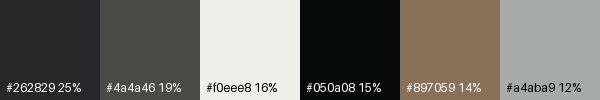

# REF-1GowFTjbUnk: NVIDIA Explained Like You're 5

Channel: Crayon Capital | Duration: 14:29 (869s) | Views: 1776004 | Uploaded: 20260709
Source: https://www.youtube.com/watch?v=1GowFTjbUnk | Analysed 2026-11-14 at <=480p (refwatch). Labels: [V] measured, [E] estimate/heuristic.

## Description

```
Stop rehearsing the disaster and start solving it. Click the link for 10% off your first month of BetterHelp: https://betterhelp.com/crayoncapital #ad 

Video source:
https://docs.google.com/document/d/12D9rV3okUNGqIRfmaJfCCj_J839pwXHf3w9Ytq7oqLM/edit?usp=sharing

Timestamps
0:00 Two Years Building the Wrong Chip
5:43  The $500M Bet on PhD Students Nobody Wanted
9:18 The 2012 Competition That Proved Jensen Right
11:03 Blocked at Every Turn, $3 Trillion Valuation Anyway


⚠️ Disclaimer
This video is for educational and entertainment purposes only. Some details may be simplified or contain inaccuracies. Always conduct your own research to gain a deeper understanding of the topic.

💼 Business Inquiries: contact.crayoncapital@gmail.com

🛑 Copyright Notice
If you have any copyright concerns, don't hesitate to contact me. I’ll be happy to work on a fair resolution. Please use "Copyright Issue" as the subject of your email.

#nvidia #crayoncapital
```

## Chapters / structure

- 0:00  Two Years Building the Wrong Chip
- 5:43  The $500M Bet on PhD Students Nobody Wanted
- 9:18  The 2012 Competition That Proved Jensen Right
- 11:03  Blocked at Every Turn, $3 Trillion Valuation Anyway

## Metrics (columns: this video | UF reference | our animatic)

UF = Unknown Frequencies mJS-QVw8lzY, FORMAT-BIBLE.md sections 1-2. Ours = QA-ANIMATIC.md / text_metrics.json. "-" = no baseline.

| Metric | This video | UF | Ours |
|---|---|---|---|
| Words per minute | n/a (no captions) | 178 | 155.2 |
| Sentences/min | n/a (no captions) | 18.5 | 13.8 |
| Words/sentence mean | n/a (no captions) | 9.6 | 11.2 |
| Words/sentence median | n/a (no captions) | 8 | 11 |
| % sentences <=6 words | n/a (no captions) | 39.5 | 24.1 |
| Questions/min | n/a (no captions) | 1.22 | 0.29 |
| Hard cuts/min (shots/min) | 13.8 | 10.7 | 9.5 |
| Pops/min (10-30% px) | 60.1 | 7.4 | 6.5 |
| Visible changes/min (>=10% px) | 76.8 | 18.1 | 16 |
| Shot length median s | 3.94 | 4.2 | 4.89 |
| Shot length p90 s | 7.73 | 12.3 | 8.8 |
| Shot length max s | 20.1 | - | 11.81 |
| Shot length p10 s | 1.43 | - | - |
| White-dominant frames % (>60% px lum>235) | 4.7 | - | - |
| White-dominant frames % (>40% px lum>235) | 8.5 | 25.6 | 41.9 |
| Mean luminance /255 | 100.9 | 135 | 59 (draft v1) |
| Text share [E]: mean strong-edge density / % frames >2% | 0.0274 / 63.8 | - | - |

Caveat: FORMAT-BIBLE pops/min (7.4) and visible changes/min (18.1) came from the Editor's windowed seg2 detector; the raw events.js detector used here gives about 11 and 25 on UF itself (see README). Compare other videos against the UF re-run in refs/mJS-QVw8lzY/METRICS.json for like-for-like pops and visible changes.

Detector: 30 fps, 320x180 gray; events = local maxima of mean frame diff >2.5; cut = >=30% of 80x45 pixels changed by >25 and >=0.45 s after the previous cut; pop = 10-30%. Same settings as analysis_teardown_scripts (events.js, shots.py).

## Palette (6 colours, k-means on 1 fps frames)



`#262829` 25.2% `#4a4a46` 18.8% `#f0eee8` 16.3% `#050a08` 14.6% `#897059` 13.5% `#a4aba9` 11.5%

## Hook (first 30 s)

Sheet: `hook_sheet.jpg` (one frame per second).

Shots: 0.0+5.1s, 5.1+3.6s, 8.7+5.2s, 13.9+3.5s, 17.4+6.7s, 24.1+2.1s, 26.2+1.9s, 28.1+1.7s, 29.8+3.6s

Words: (no captions)

## Sheets

- `shots_0.jpg`
- `shots_1.jpg`
- `shots_2.jpg`
- `shots_3.jpg`
- `shots_4.jpg`

Each cell: shot number, start time, shot length. 8 columns, <=40 shots per sheet. View with view_image.

## Recipe (Morpheus fills this by viewing the sheets; leave blank until viewed)

### Script grammar


### Visual grammar


### Pacing


### What to copy


### What to avoid


## Recipe (written 2026-11-14 from METRICS.json plus shot sheets hook, 0, 2, 4; sheets 1 and 3 not viewed; NO captions, so no script-grammar numbers)

What it is: modern business-history explainer (Crayon Capital, Nvidia), 14:29, 1.78M views, one BetterHelp sponsor read, 4 narrative-statement chapters. William sent it 11/14 as a model for modern-topic videos.

Measured [V]: 200 shots, 13.8 cuts/min, median shot 3.9 s (p10 1.4, p90 7.7), 60 pops/min (heavy in-shot motion), white-dominant frames 4.7% (dark and cream palette), text-heavy frames about 64% [E].

Visual grammar [E]: flat vector cartoon with round-headed, bold-feature characters (glasses, hair as identity), ONE recurring protagonist plus small recurring cast, a few reused locations (the Denny's diner recurs), props as icons (chip, jar labelled SAVINGS, calendar reading 1993 / 2020 / Late 2023). Heavy on-screen text: speech bubbles, dates, big counters (REVENUE per hour $20,000,000), company logos, chess-board metaphors. Many near-black frames with a single line of handwritten white text as a punchline or beat divider (cheap, no image generation).

Hook [E]: cold-open scene with a tiny human moment (dishwasher, diner), a big-number jump cut ("34 years later... $20,000,000 per hour"), a stakes line in a speech bubble ("We burned $500 million dollars for this"), then the chapter title card at 0:28 ("Two Years Building the Wrong Chip") phrased as a story claim.

Description craft: timestamps, a linked source document, a plain "details may be simplified" disclaimer.

Copy: number-first hook, claim-style chapter titles, black punchline frames, recurring cast and locations, dates and counters as visual anchors, linked sources doc. Avoid for us: the sponsor read, and depicting a living CEO as a recognisable caricature until the modern-topic guardrails are written.

Conflict with PROCESS.md rule 8 (no text cards, bands, stamps or chips): that rule came from the myth lane. This reference suggests modern, number-driven topics need on-screen text. Decision for William before any modern video.
