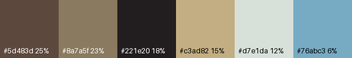

# REF-fzWO_YZG0fg: The ENTIRE History of ROME in 13 Minutes

Channel: Globa1 | Duration: 13:15 (795s) | Views: 1545 | Uploaded: 20260921
Source: https://www.youtube.com/watch?v=fzWO_YZG0fg | Analysed 2026-11-13 at <=480p (refwatch). Labels: [V] measured, [E] estimate/heuristic.

## Description

```
From a tiny village that nobody took seriously — to the most powerful empire the ancient world had ever seen.

This is the complete story of Rome. From its legendary founding in 753 BC, through the rise of the Republic, the wars against Carthage, the fall of Caesar, and the collapse of the Western Empire in 476 AD.

In 13 minutes.

⏱️ TIMESTAMPS:
00:00 — The Impossible Empire
00:45 — It Started With Almost Nothing
03:42 — The Machine
05:56 — The Price of Winning
08:22 — One Man
10:53 — The Last Act

📚 WANT TO LEARN MORE?
These books will blow your mind:

SPQR by Mary Beard — the best modern history of Rome
Rubicon by Tom Holland — the fall of the Republic told like a thriller
The Storm Before the Storm by Mike Duncan — the men who destroyed the Republic before Caesar
Caesar by Adrian Goldsworthy — the definitive biography

🔔 Subscribe for a new civilization every week — you won't want to miss what's coming next.

#Rome #AncientRome #RomanEmpire #History #WorldHistory #AncientHistory #JuliusCaesar #RomanRepublic #globalhistory
```

## Chapters / structure

- 0:00  The Impossible Empire
- 0:45  It Started With Almost Nothing
- 3:42  The Machine
- 5:56  The Price of Winning
- 8:22  One Man
- 10:53  The Last Act

## Metrics (columns: this video | UF reference | our animatic)

UF = Unknown Frequencies mJS-QVw8lzY, FORMAT-BIBLE.md sections 1-2. Ours = QA-ANIMATIC.md / text_metrics.json. "-" = no baseline.

| Metric | This video | UF | Ours |
|---|---|---|---|
| Words per minute | 159.1 | 178 | 155.2 |
| Sentences/min | 18.9 | 18.5 | 13.8 |
| Words/sentence mean | 8.4 | 9.6 | 11.2 |
| Words/sentence median | 7.0 | 8 | 11 |
| % sentences <=6 words | 48.8 | 39.5 | 24.1 |
| Questions/min | 0.38 | 1.22 | 0.29 |
| Hard cuts/min (shots/min) | 14.9 | 10.7 | 9.5 |
| Pops/min (10-30% px) | 2.6 | 7.4 | 6.5 |
| Visible changes/min (>=10% px) | 30.7 | 18.1 | 16 |
| Shot length median s | 3.83 | 4.2 | 4.89 |
| Shot length p90 s | 6.36 | 12.3 | 8.8 |
| Shot length max s | 9.1 | - | 11.81 |
| Shot length p10 s | 1.7 | - | - |
| White-dominant frames % (>60% px lum>235) | 1.1 | - | - |
| White-dominant frames % (>40% px lum>235) | 1.7 | 25.6 | 41.9 |
| Mean luminance /255 | 118.3 | 135 | 59 (draft v1) |
| Text share [E]: mean strong-edge density / % frames >2% | 0.0434 / 78.1 | - | - |

Caveat: FORMAT-BIBLE pops/min (7.4) and visible changes/min (18.1) came from the Editor's windowed seg2 detector; the raw events.js detector used here gives about 11 and 25 on UF itself (see README). Compare other videos against the UF re-run in refs/mJS-QVw8lzY/METRICS.json for like-for-like pops and visible changes.

Detector: 30 fps, 320x180 gray; events = local maxima of mean frame diff >2.5; cut = >=30% of 80x45 pixels changed by >25 and >=0.45 s after the previous cut; pop = 10-30%. Same settings as analysis_teardown_scripts (events.js, shots.py).

## Palette (6 colours, k-means on 1 fps frames)



`#5d483d` 25.1% `#8a7a5f` 22.9% `#221e20` 18.5% `#c3ad82` 14.6% `#d7e1da` 12.5% `#76abc3` 6.3%

## Hook (first 30 s)

Sheet: `hook_sheet.jpg` (one frame per second).

Shots: 0.0+1.0s, 1.0+4.0s, 5.1+2.6s, 7.7+3.5s, 11.2+4.9s, 16.1+6.0s, 22.2+2.7s, 24.8+2.3s, 27.1+2.1s, 29.3+1.7s

Words: At its peak, Rome controlled 1/4 of the entire human population on Earth. Not one country, not one continent. 1/4 of every single person alive on the planet. They built roads so perfectly engineered that cars still drive on them today. They invented concrete, running water, and the idea that every citizen deserves the protection of the law. And then, in less than a century, it all came crashing down. But here's what makes the story different. Rome didn't start

## Sheets

- `shots_0.jpg`
- `shots_1.jpg`
- `shots_2.jpg`
- `shots_3.jpg`
- `shots_4.jpg`

Each cell: shot number, start time, shot length. 8 columns, <=40 shots per sheet. View with view_image.

## Recipe (Morpheus fills this by viewing the sheets; leave blank until viewed)

### Script grammar


### Visual grammar


### Pacing


### What to copy


### What to avoid


Recipe filled 2026-11-13: see `refs/RECIPE-2026-11-13.md` (five-video synthesis; this video is one column of the table and is discussed in sections 2-3).
