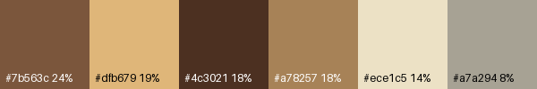

# REF-rugqa9owECY: Why Romans Never Used Archers

Channel: Stick Secrets | Duration: 11:15 (676s) | Views: 141732 | Uploaded: 20261101
Source: https://www.youtube.com/watch?v=rugqa9owECY | Analysed 2026-11-13 at <=480p (refwatch). Labels: [V] measured, [E] estimate/heuristic.

## Description

```
Discover why Romans never used archers, even while horse archers were destroying their legions. This breakdown explains how the greatest army of the ancient world refused the bow for centuries, and what it finally became.

In 53 BC, at Carrhae, a Roman legionary crouches inside a huge square of shields while the sky turns dark with arrows. The Parthian horse archers ride in circles, just out of reach, and camels keep bringing them fresh arrows. Crassus loses his army, his son, his life, and the eagles of his legions.

This video examines the ancient accounts from Polybius, Plutarch, Arrian, Vegetius and Procopius. You will learn why the Roman legion had no bows, how Mark Antony's men beat the arrows with the tortoise, why Rome hired archers from Crete and Syria instead of training its own, and how Syrian archers ended up guarding Hadrian's Wall. We look at the strange twist of the story: six hundred years after Carrhae, the Roman soldier had become an armored horse archer himself.

Subscribe for weekly ancient history breakdowns, and tell me in the comments: in that desert, would you rather be the legionary with the shield, or the archer on the horse?

Chapters
0:00 Carrhae, 53 BC
1:07 A legion without bows
3:00 The desert
5:45 Rome goes shopping
7:44 A Roman picks up a bow
9:04 The last twist

Main sources: Polybius, Histories 6; Plutarch, Crassus 20-33 and Antony 45; Thucydides 4.40; Augustus, Res Gestae 29; Arrian, Order of Battle against the Alans; Vegetius, Epitoma rei m
```

## Chapters / structure

- 0:00  Carrhae, 53 BC
- 1:07  A legion without bows
- 3:00  The desert
- 5:45  Rome goes shopping
- 7:44  A Roman picks up a bow
- 9:04  The last twist

## Metrics (columns: this video | UF reference | our animatic)

UF = Unknown Frequencies mJS-QVw8lzY, FORMAT-BIBLE.md sections 1-2. Ours = QA-ANIMATIC.md / text_metrics.json. "-" = no baseline.

| Metric | This video | UF | Ours |
|---|---|---|---|
| Words per minute | 151.7 | 178 | 155.2 |
| Sentences/min | 14.6 | 18.5 | 13.8 |
| Words/sentence mean | 10.4 | 9.6 | 11.2 |
| Words/sentence median | 10.0 | 8 | 11 |
| % sentences <=6 words | 28.0 | 39.5 | 24.1 |
| Questions/min | 0.27 | 1.22 | 0.29 |
| Hard cuts/min (shots/min) | 23.0 | 10.7 | 9.5 |
| Pops/min (10-30% px) | 125.4 | 7.4 | 6.5 |
| Visible changes/min (>=10% px) | 158.1 | 18.1 | 16 |
| Shot length median s | 2.3 | 4.2 | 4.89 |
| Shot length p90 s | 3.34 | 12.3 | 8.8 |
| Shot length max s | 25.9 | - | 11.81 |
| Shot length p10 s | 1.74 | - | - |
| White-dominant frames % (>60% px lum>235) | 0.0 | - | - |
| White-dominant frames % (>40% px lum>235) | 0.0 | 25.6 | 41.9 |
| Mean luminance /255 | 135.6 | 135 | 59 (draft v1) |
| Text share [E]: mean strong-edge density / % frames >2% | 0.0613 / 92.8 | - | - |

Caveat: FORMAT-BIBLE pops/min (7.4) and visible changes/min (18.1) came from the Editor's windowed seg2 detector; the raw events.js detector used here gives about 11 and 25 on UF itself (see README). Compare other videos against the UF re-run in refs/mJS-QVw8lzY/METRICS.json for like-for-like pops and visible changes.

Detector: 30 fps, 320x180 gray; events = local maxima of mean frame diff >2.5; cut = >=30% of 80x45 pixels changed by >25 and >=0.45 s after the previous cut; pop = 10-30%. Same settings as analysis_teardown_scripts (events.js, shots.py).

## Palette (6 colours, k-means on 1 fps frames)



`#7b563c` 24.4% `#dfb679` 18.7% `#4c3021` 18.1% `#a78257` 17.5% `#ece1c5` 13.6% `#a7a294` 7.7%

## Hook (first 30 s)

Sheet: `hook_sheet.jpg` (one frame per second).

Shots: 0.0+2.6s, 2.6+2.8s, 5.4+2.6s, 8.0+2.0s, 10.0+2.8s, 12.8+3.7s, 16.5+1.6s, 18.2+2.1s, 20.2+2.3s, 22.5+1.9s, 24.4+2.3s, 26.8+2.9s, 29.7+2.1s

Words: Rome conquered half the known world without a single archer of its own. Mesopotamia, 53 BC. A Roman legionary stands in the desert inside a huge square of shields. The sky above him is turning dark, not with clouds, with arrows. Our legionary has a sword, a shield, two heavy javelins. He has crossed half the world. He has beaten Gauls, Greeks, Spaniards, and right now he can't touch a single one of

## Sheets

- `shots_0.jpg`
- `shots_1.jpg`
- `shots_2.jpg`
- `shots_3.jpg`
- `shots_4.jpg`
- `shots_5.jpg`
- `shots_6.jpg`

Each cell: shot number, start time, shot length. 8 columns, <=40 shots per sheet. View with view_image.

## Recipe (Morpheus fills this by viewing the sheets; leave blank until viewed)

### Script grammar


### Visual grammar


### Pacing


### What to copy


### What to avoid


Recipe filled 2026-11-13: see `refs/RECIPE-2026-11-13.md` (five-video synthesis; this video is one column of the table and is discussed in sections 2-3).
