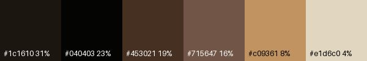

# REF-xE5uEHqi8oU: Baba Yaga Is Older Than You Think: The True Story of the Slavic Witch

Channel: Slavique | Duration: 16:31 (992s) | Views: 140512 | Uploaded: 20260130
Source: https://www.youtube.com/watch?v=xE5uEHqi8oU | Analysed 2026-11-18 at <=480p (refwatch). Labels: [V] measured, [E] estimate/heuristic.

## Description

```
Our instagram: https://www.instagram.com/slavique_channel
Patreon for support: patreon.com/SlaviqueOfficial

Deep in the dark forests of Slavic legend, on the very border between the world of the living and the realm of the dead, stands a strange hut on chicken legs. No doors. No windows. A spinning gateway that can only be opened by a secret phrase. And inside waits one of the most terrifying and misunderstood figures in mythology — Baba Yaga.

Most people know her as a wicked forest witch, a scary old woman who kidnaps children and threatens to roast them in her oven. Parents still use her name to frighten kids, and pop culture often turns her into a comic villain. But what if this image is only a mask?

In this video, we journey deep into Slavic mythology to uncover the true nature of Baba Yaga. Was she really an evil sorceress, or was she once a powerful goddess, a guardian of ancient knowledge, and a guide between worlds?

We explore her terrifying appearance, the meaning of her bony leg, her strange hut, and her role as a tester of heroes. You’ll learn why Baba Yaga lives on the boundary between life and death, why she smells the living, and why she both threatens and helps those who enter her domain. We also uncover shocking connections to ancient burial rites, initiation rituals, shamanic practices, and forgotten pagan beliefs.

Drawing on folklore, archaeology, and the work of legendary scholars, this video reveals how Baba Yaga evolved over thousands of years from a
```

## Chapters / structure

- 0:00  Who lives in the depths of the forest?
- 1:24  Baba Yaga in modern culture
- 2:51  The frightening appearance of Baba Yaga
- 3:56  A stove, a hut, and a mortar with a broom
- 5:23  The grumpy nature of Baba Yaga
- 6:45  Baba Yaga - the guardian of the border
- 8:25  Why is Baba Yaga a negative character in fairy tales?
- 9:35  The ancient basis of Baba Yaga's image
- 11:51  Why does Baba Yaga put children in the oven
- 12:26  The initiation ritual
- 13:30  Baba Yaga is older than you think

## Metrics (columns: this video | UF reference | our animatic)

UF = Unknown Frequencies mJS-QVw8lzY, FORMAT-BIBLE.md sections 1-2. Ours = QA-ANIMATIC.md / text_metrics.json. "-" = no baseline.

| Metric | This video | UF | Ours |
|---|---|---|---|
| Words per minute | 144.8 | 178 | 155.2 |
| Sentences/min | 10.3 | 18.5 | 13.8 |
| Words/sentence mean | 14.1 | 9.6 | 11.2 |
| Words/sentence median | 13.0 | 8 | 11 |
| % sentences <=6 words | 13.5 | 39.5 | 24.1 |
| Questions/min | 0.61 | 1.22 | 0.29 |
| Hard cuts/min (shots/min) | 8.4 | 10.7 | 9.5 |
| Pops/min (10-30% px) | 21.1 | 7.4 | 6.5 |
| Visible changes/min (>=10% px) | 31.2 | 18.1 | 16 |
| Shot length median s | 6.2 | 4.2 | 4.89 |
| Shot length p90 s | 14.1 | 12.3 | 8.8 |
| Shot length max s | 33.0 | - | 11.81 |
| Shot length p10 s | 1.5 | - | - |
| White-dominant frames % (>60% px lum>235) | 0.9 | - | - |
| White-dominant frames % (>40% px lum>235) | 0.9 | 25.6 | 41.9 |
| Mean luminance /255 | 54.2 | 135 | 59 (draft v1) |
| Text share [E]: mean strong-edge density / % frames >2% | 0.0055 / 3.0 | - | - |

Caveat: FORMAT-BIBLE pops/min (7.4) and visible changes/min (18.1) came from the Editor's windowed seg2 detector; the raw events.js detector used here gives about 11 and 25 on UF itself (see README). Compare other videos against the UF re-run in refs/mJS-QVw8lzY/METRICS.json for like-for-like pops and visible changes.

Detector: 30 fps, 320x180 gray; events = local maxima of mean frame diff >2.5; cut = >=30% of 80x45 pixels changed by >25 and >=0.45 s after the previous cut; pop = 10-30%. Same settings as analysis_teardown_scripts (events.js, shots.py).

## Palette (6 colours, k-means on 1 fps frames)



`#1c1610` 30.8% `#040403` 22.8% `#453021` 18.8% `#715647` 16.0% `#c09361` 8.0% `#e1d6c0` 3.6%

## Hook (first 30 s)

Sheet: `hook_sheet.jpg` (one frame per second).

Shots: 0.0+4.9s, 4.9+18.8s, 23.7+4.1s, 27.8+0.5s, 28.3+3.5s

Words: According to Slavic legends, deep within a dark, eerie forest lies the boundary between the world of the living and the world of the dead. On that boundary stands a hut. It looks nothing like the houses we're used to. Old and darkened by time, it stands high on chicken legs. It has no windows and no doors. And to enter it, you must know a special phrase and [music] make it turn around. But should you enter at all,

## Sheets

- `shots_0.jpg`
- `shots_1.jpg`
- `shots_2.jpg`
- `shots_3.jpg`

Each cell: shot number, start time, shot length. 8 columns, <=40 shots per sheet. View with view_image.

## Recipe (Morpheus fills this by viewing the sheets; leave blank until viewed)

### Script grammar


### Visual grammar


### Pacing


### What to copy


### What to avoid

